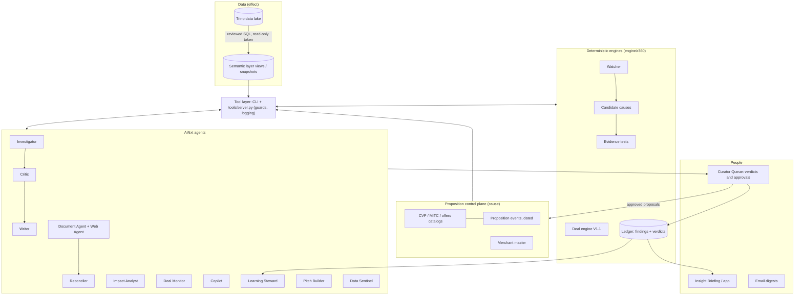

# RuPay 360: architecture (redesigned around AiNxt, 2026-11-23)

## 1. What changed from the first design
| Before | Now |
|---|---|
| Models only extract documents and word explanations | Agents investigate: they form hypotheses, write and run their own SQL, invent metrics, challenge each other. Arithmetic still comes from SQL and tested engines. |
| A scheduled job on "an internal machine" | AiNxt Scheduler and Workflows orchestrate; the internal machine only hosts the tool server that can reach Trino. |
| Copilot as a future drawer in the app | AiNxt chat (a Copilot harness) from day one; the app shows findings and modules. |
| Manual scraping (what I did in this chat) | AiNxt Web Agent jobs with hash-diff; Document Agent proposes catalog changes. |
| Pull requests as the only approval | AiNxt Curator Queue for day-to-day approvals; Git merges for code and catalog files (ADLC Pipeline). |
| "Learning" undefined | Ledger of findings + analyst verdicts + scorecard + playbooks + tuned thresholds. |

## 2. Layers

## 3. The intelligence loop (who does what)
| Step | Done by | Why that way |
|---|---|---|
| 1. Detect unusual moves | Watcher (code) | Cheap, consistent, runs on everything every day |
| 2. List what could explain it | Candidate-cause lookup (code) + Investigator (agent adds causes not in the catalogs) | Code covers known causes; the agent covers the unknown |
| 3. Test each explanation | Evidence tests (code) + agent-written SQL | Agents can invent tests and metrics; numbers come from queries |
| 4. Try to break it | Critic (agent, different model family) | Independence reduces confident mistakes |
| 5. Explain it | Writer (agent); number check (code) | Readable, but cannot invent figures |
| 6. Judge it | Analyst in the Curator Queue | Ground truth for learning |
| 7. Learn | Scorecard (code) + Learning Steward (agent) -> thresholds, priors, playbooks (approved) | Improves without model training |

**On "agents don't calculate":** agents choose *what* to measure, including ratios nobody asked for. They write the SQL or call an engine to get the number, then reason about it. They never do the arithmetic themselves. If a new metric proves useful it becomes permanent through `r360_propose_metric`.

## 4. Where agents help across the platform
| Module | Agent use | Workflow |
|---|---|---|
| Command Center | Daily briefing of unusual moves with causes; near-cliff users (CVP milestone and fee-waiver gates) | W1 |
| Card Economics | Acceptance-leakage investigations (decline clusters by MID / error code); interchange reconciliation once schedules are loaded | W1 (new flag types) |
| Wallet Share | Silent wallet-migration radar: card spend down while customer's other spend holds | W1 (new flag type) |
| Proposition Hub | Catalog upkeep (Web Agent, Document Agent, Reconciler); impact of every CVP/MITC change and offer at D+30 / D+60; cross-network comparisons | W2, W3 |
| Deal Performance | Monthly actual-vs-baseline, cliff alerts, re-forecasts via the engine | W4 |
| Issuer conversations | Evidence packs for YES / IDFC RuPay migration or expansion pitches | On demand (Pitch Builder) |
| Whole platform | Copilot Q&A; weekly digest; data quality gate; learning loop; code changes via ADLC Pipeline | W5, W6, W7, W8 |

## 5. Where state lives ("save where I left off")
| State | Lives in | How it is kept |
|---|---|---|
| Catalogs, events, merchant master, schemas, engines, thresholds | Git repo (GitHub: felixepitaph/RuPay-360View) | Merge history = audit trail |
| Findings and verdicts | `ledger/findings.jsonl`, `ledger/verdicts.jsonl` in the repo | Appended by tools; committed by the daily workflow |
| Proposals awaiting approval | `proposals/` + AiNxt Curator Queue | Cleared on approve / reject |
| Learned patterns | `ainxt/wikis/playbooks.md` (mirrored to the AiNxt wiki) | Approved proposals only |
| Conversation context | AiNxt Project memory and chat history | Facts only, editable by you |
| Data | Trino; snapshots as reviewed aggregates | Re-runnable SQL in `sql/` |
| Every query an agent ran | `runs/query_log.jsonl` | Each number traceable to its SQL |

## 6. How it updates itself
- **Data loop (daily):** snapshot SQL -> Data Sentinel -> Watcher -> investigations -> briefing.
- **Document loop (daily):** Web Agent -> hash check -> extraction of changes only -> Curator Queue -> merge -> proposition events -> impact measurement.
- **Learning loop (weekly):** verdicts -> scorecard -> proposals for thresholds, priors and playbooks.

## 7. The app (assumed: small internal web app; confirm hosting)
The app only reads files: snapshot aggregates, catalogs and the ledger. First screen built: **Insight Briefing** (`python -m r360 briefing` -> `app/briefing.html`). Modules follow the Gemini V2 layout (three workspaces) with one addition everywhere: a "Why did this move?" panel that shows the finding, its tests and sources, and the verdict buttons.
If hosting is not available soon, the briefing page and AiNxt chat are enough to run the intelligence loop; Superset can carry the plain charts.

## 8. Trust and safety built in
- Read-only data, column restrictions from `engine/config/restrictions.json` (empty by default), row cap, every query logged (`engine/r360/data_access.py`).
- Agents propose; people approve (Curator Queue, merge requests).
- Critic on every finding; "likely" language unless a control comparison supports a claim.
- Writer output checked against the bundle's numbers.
- Confidential terms never leave the internal context folder.

## 9. Known limits
- Offer history only exists from when the watcher starts; earlier periods need archived booklets and PDFs.
- Causal tests need merchant-level data with a stable merchant identity and a salted card key inside Trino (Phase 0 checks).
- Findings are associations with a comparison group, not proof.
- AiNxt specifics (tool registration format, workflow-to-code calls) are assumptions until the AiNxt team confirms.
